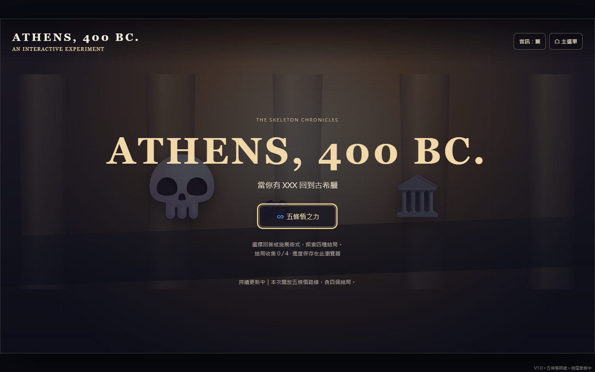
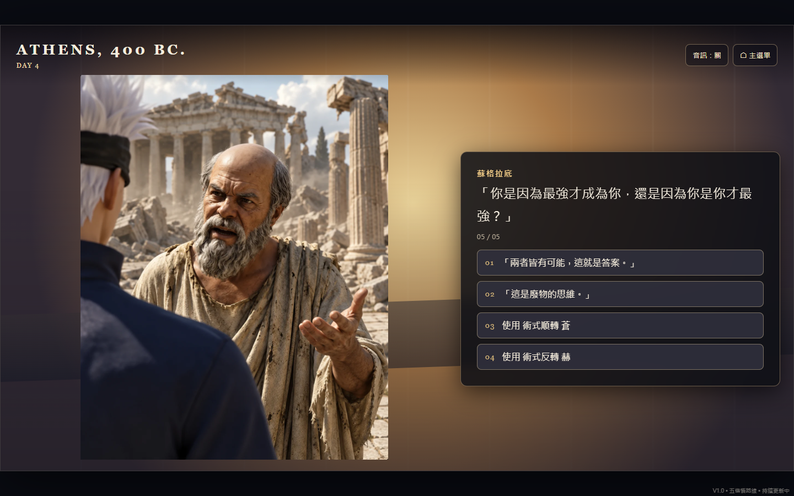
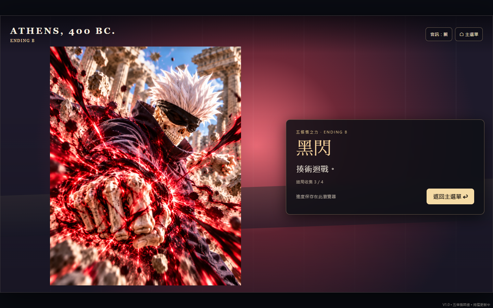
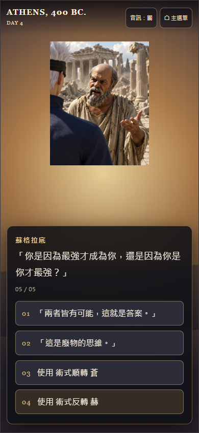

# ATHENS, 400 BC.

古希臘骷髏迷因互動視覺小說。Vibe Coding 課程作業，本次公開五條悟單路線，持續更新中。

## 網站

[開始遊玩](https://jimxpm.github.io/athens-400bc/)

網站完全包含於單一 `index.html`：內嵌 HTML、CSS、JavaScript 及 15 張 WebP 圖片，約 7 MB，不需安裝套件或連接後端。

## 規格

- Day 1–3 固定敘事，展示無下限、蒼與赫。
- Day 4 回答蘇格拉底的提問或選擇使用術式；每個選項先顯示反應。
- 存活分支在一週後進入三選一決戰；死亡分支隔天揭露縫合線與獄門疆。
- 四個結局：領域對決、黑閃、虛式茈、羂索陷阱。
- 逐字字幕、標點停頓、顯示完成後短暫閱讀停頓；期間鎖定推進及選項，避免連按略過。
- 圖片隨台詞與分支切換，術式搭配閃光與震動；支援減少動態效果偏好。
- 桌面採圖文分區，手機採上圖下文；完整保留圖片比例。
- 結局收集以 localStorage 保存在同一瀏覽器；可返回主選單重玩。
- 滑鼠、觸控、Enter、空白鍵及數字選項操作。

## 介面截圖

## AI 協作與修改過程

從既有 V0.1 原型開始，先請 AI 分析架構，再逐步調整劇情資料、選項反應、時間設定與結局流程。開發過程將劇情與渲染邏輯分離，依提供的圖片逐張配置到對應節點。

加入素材後，將原本較小的中央舞台擴大，改為保持圖片比例的圖文分區，並處理手機直式圖片。後續微調選項措辭、蘇格拉底的哲學式反問，增加逐字字幕與防連按機制。

配合作業範圍，先公開圖片已完成的五條悟路線，取消解鎖限制，將樣式、程式與圖片整理成單一 HTML。開發專案中的 PS5 路線尚未公開。

## 驗證與目前範圍

已檢查桌面與手機各八條完整分支路徑、四個結局、內嵌圖片、結局紀錄重載、防連按、直接開啟 HTML，以及不依賴外部素材請求。測試未捕捉到 JavaScript 執行錯誤。

音訊開關與載入欄位已預留，但目前沒有實際旁白、音樂或音效。作品使用所提供的圖片素材與迷因／動畫元素作為課程創作內容，並非相關作品的官方網站。
